<!-- Profile README for sury-aaa -->

 

**BTech Computer Science student building computer-vision and data-driven systems.**

 

 

 

 

 

<table>
<tr>
<td width="50%" valign="top">

### 🚑 [ambulance-signal](https://github.com/sury-aaa/ambulance-signal)
Detects an ambulance in a traffic camera feed and gives its lane the green signal.

- YOLOv8 detector trained on a Roboflow dataset, tuned with negative frames to cut false positives (Ambulance mAP50 **0.888**)
- Signal controller state machine with minimum-yellow and all-red safety gaps
- Pygame demo simulating 3-lane priority switching

`Python` `YOLOv8` `Pygame` `Roboflow`

</td>
<td width="50%" valign="top" align="center">

<!-- Update the path if demo.gif lives in a subfolder -->

</td>
</tr>
<tr>
<td colspan="2" valign="top">

### 🗳️ [E-Governance Blockchain Voting System](https://github.com/sury-aaa/e-governance-blockchain-voting)
Academic project website exploring transparent, tamper-resistant digital voting.

`Blockchain` `Web`

</td>
</tr>
</table>

 

Metrics from the <a href="https://github.com/sury-aaa/ambulance-signal">ambulance-signal</a> project

 

*"Friends don't lie."* — and neither do well-tested programs.

