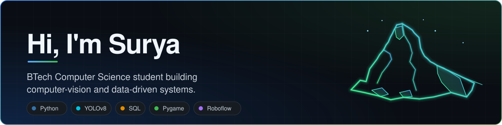
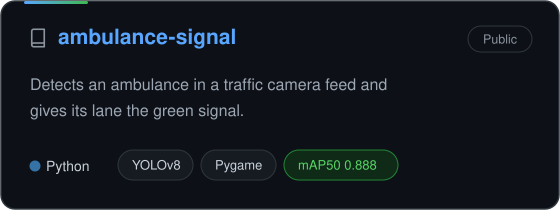
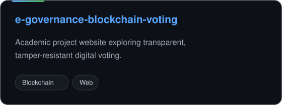

<!-- Profile README for sury-aaa -->

  

  

 

 

**ambulance-signal**

- YOLOv8 detector trained on a Roboflow dataset, with negative frames added to cut false positives (Ambulance mAP50 **0.888**)
- Signal controller built as a state machine, with minimum-yellow and all-red safety gaps
- Pygame demo that simulates priority switching across 3 lanes

<!-- Update the path if demo.gif lives in a subfolder -->

 

 

 

 

